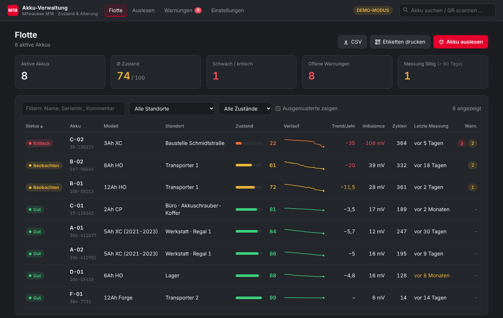
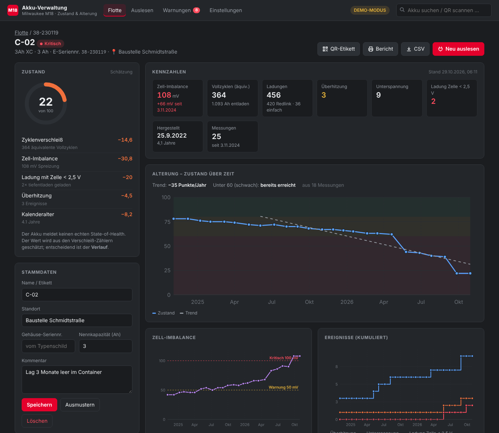
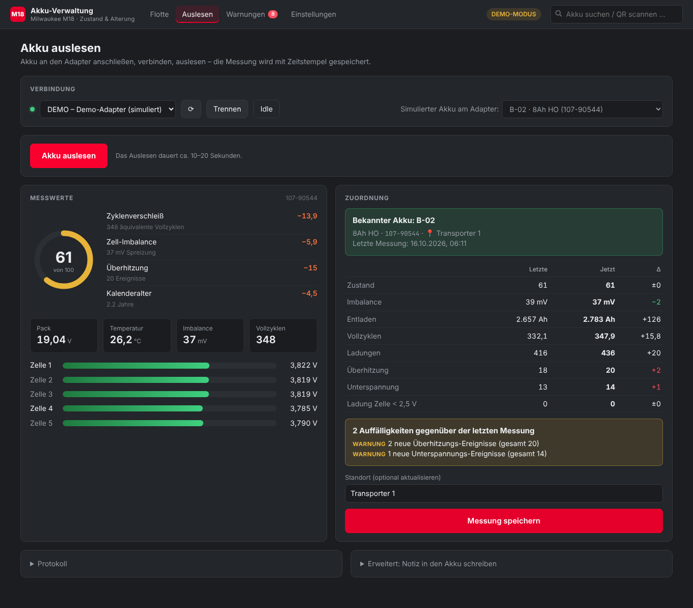
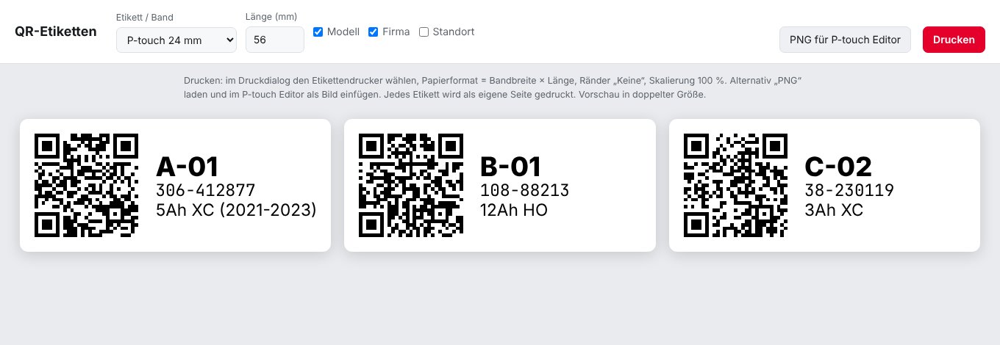
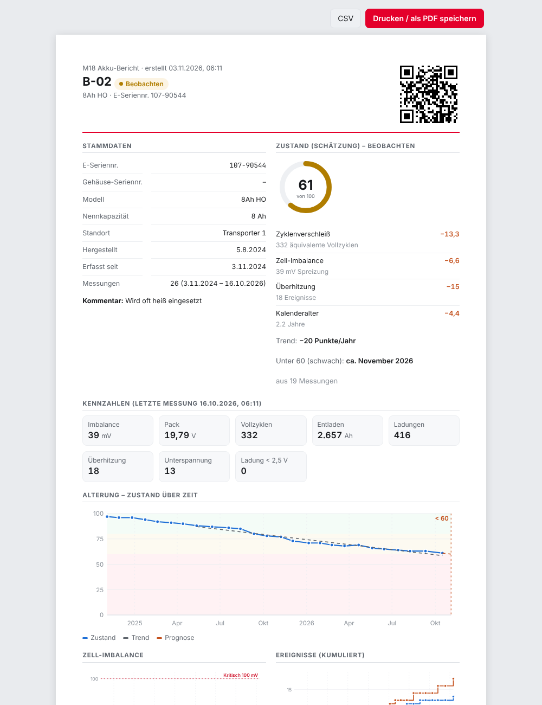
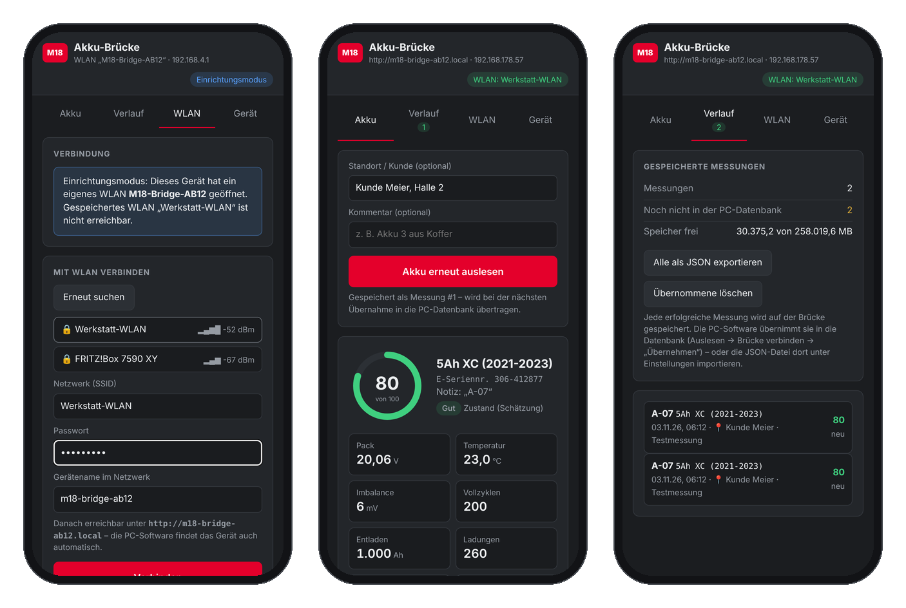
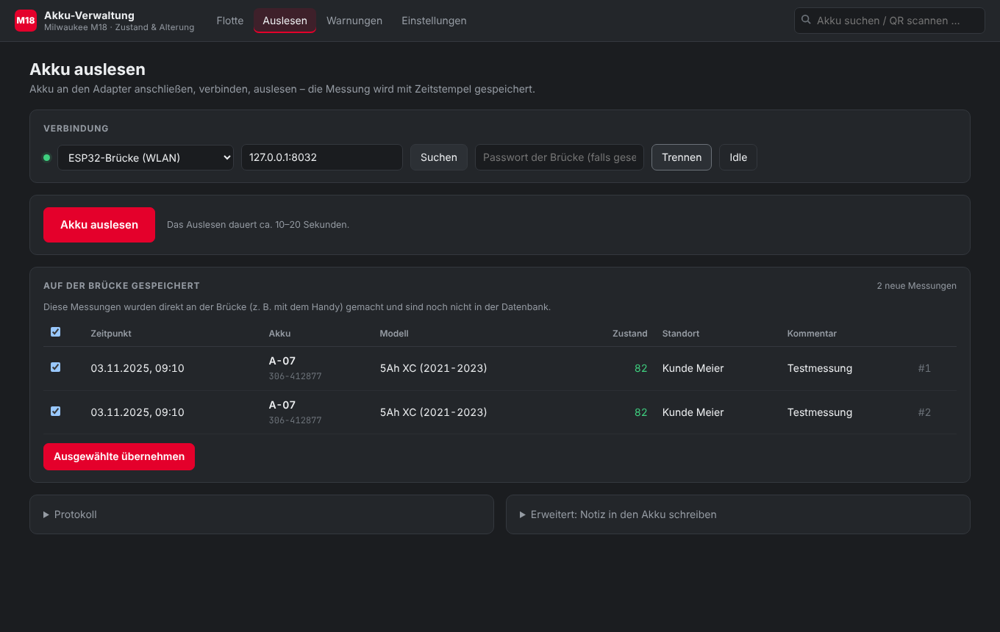
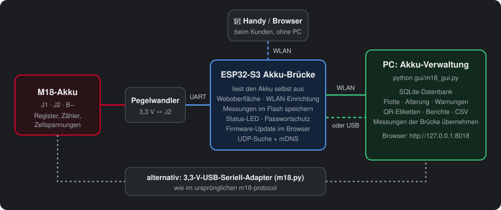
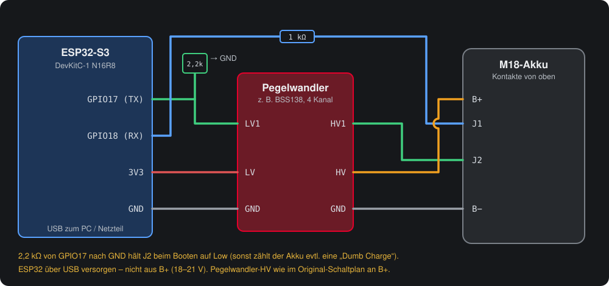

# M18 Akku-Verwaltung

[](https://github.com/danunt97/m18-protocol/actions/workflows/tests.yml)


Mit diesem Tool **liest du Milwaukee-M18-Akkus aus, verwaltest sie in einer Datenbank und verfolgst ihre Alterung**.
Das Programm läuft als lokaler Webserver auf dem eigenen PC, ohne Installation und ohne Cloud. Auf Wunsch übernimmt
eine **ESP32-S3-Brücke** das Auslesen per WLAN oder direkt vor Ort mit dem Handy.

Das Projekt baut auf der Protokoll-Forschung von [mnh-jansson/m18-protocol](https://github.com/mnh-jansson/m18-protocol) auf.



## Funktionen

**Akku-Verwaltung (PC, `gui/`)**
- **Auslesen** über einen 3,3-V-USB-Seriell-Adapter oder die ESP32-Brücke. Bekannte Akkus erkennt das Programm automatisch, neue legt es mit einem Klick an.
- **Datenbank (SQLite):** jede Messung mit Zeitstempel, allen Zählern und den rohen Registerwerten.
- **Flottenübersicht:** Zustand, Verlauf, Trend, Zell-Imbalance, Zyklen, Standort, fällige Messungen und offene Warnungen. Die Liste lässt sich filtern und sortieren.
- **Alterung:** Diagramme pro Akku und eine Prognose, wann der Akku schwach wird.
- **Warnungen**, wenn sich ein Akku deutlich verschlechtert: Zustandsabfall, steigende Imbalance, neue Überhitzungs- oder Unterspannungs-Ereignisse, Ladung mit einer Zelle unter 2,5 V.
- **Standort, Kommentar und Gehäuse-Seriennummer** sind editierbar; Akkus lassen sich ausmustern.
- **QR-Etiketten** für P-touch (12–36 mm) und Brother QL (62 mm). Der QR-Code führt direkt zur Akku-Seite, der Code wird offline erzeugt.
- **Berichte:** druckbare A4-Seite bzw. PDF pro Akku, CSV pro Akku oder für die ganze Flotte, Datenbank-Backup.
- **Demo-Modus** mit 8 simulierten Akkus und 2 Jahren Verlauf, ganz ohne Hardware.

**ESP32-S3-Akku-Brücke (`esp32-bridge/`)**
- **Ersetzt den USB-Seriell-Adapter.** Der PC verbindet sich per USB oder WLAN und findet die Brücke im Netz automatisch.
- **Eigene Weboberfläche fürs Handy:**
  - Akku direkt auslesen, mit Zustand, Zellspannungen, Zählern und Daten
  - WLAN-Einrichtung beim Kunden (Captive Portal)
  - Verlauf, Status-LED, Firmware-Update im Browser
- **Messungen offline speichern** (mehrere tausend im Flash) und später **in die PC-Datenbank übernehmen**. Dafür werden die Rohregister gespeichert; eine übernommene Messung ist gleichwertig mit einer am PC.
- **Robust:**
  - Wiederholungen und schneller Abbruch bei gezogenem Akku
  - Watchdog
  - J2 bleibt im Ruhezustand sicher auf Low, damit der Akku keine „Dumb Charge“ zählt
- **Optionaler Passwortschutz.** Einstellungen ändern geht nur nach einem Druck auf die BOOT-Taste.

## Bilder

| Akku-Detail mit Alterungsverlauf | Auslesen und Vergleich mit der letzten Messung |
|---|---|
|  |  |
| **QR-Etiketten (P-touch 24 mm)** | **Druckbarer Bericht** |
|  |  |

**ESP32-Brücke am Handy:** WLAN einrichten, Akku auslesen, gespeicherte Messungen



**Messungen der Brücke in die PC-Datenbank übernehmen**



> Alle Bilder stammen aus dem Demo-Modus bzw. aus dem Simulator. Die Messwerte sind simuliert.

## Schnellstart

Du brauchst **Python 3.11 oder neuer**. Weitere Pakete braucht die Demo nicht.

```bash
git clone https://github.com/danunt97/m18-protocol.git
```

```bash
cd m18-protocol
```

```bash
python gui/m18_gui.py --demo
```

Danach öffnet sich der Browser mit http://127.0.0.1:8018. Unter Windows startest du mit `py gui\m18_gui.py --demo`.

**Mit echtem Akku:**

```bash
pip install pyserial
```

```bash
python gui/m18_gui.py
```

Dann **Auslesen** → Adapter wählen → **Verbinden** → **Akku auslesen** → speichern.
Die Datenbank liegt in `data/m18_fleet.db`.

Alle Optionen (`--host 0.0.0.0` für Handy-Scans im WLAN, `--db`, `--port` …) stehen in [gui/README.md](gui/README.md).

## Hardware

Es gibt zwei Möglichkeiten, den Akku anzuschließen:



1. **3,3-V-USB-Seriell-Adapter** wie im ursprünglichen Projekt. Verdrahtung und Fehlersuche stehen in [docs/m18-protocol.md](docs/m18-protocol.md).
2. **ESP32-S3-DevKitC-1 (N16R8) als Brücke.** Das bringt WLAN, Messen ohne PC und eine eigene Weboberfläche.



Flashen mit der Arduino IDE 2. Ins Werkzeuge-Menü gehören diese Einstellungen:
- Board: **ESP32S3 Dev Module**
- Flash: **16MB**
- PSRAM: **OPI**
- Partition: **16M Flash (3MB APP/9.9MB FATFS)**
- USB CDC On Boot: **Enabled**

Danach `esp32-bridge/m18_bridge/m18_bridge.ino` hochladen. Alles Weitere zu WLAN-Einrichtung, LED, Passwort und Update
steht in [esp32-bridge/README.md](esp32-bridge/README.md).

> ⚠️ **Sicherheit:** Arbeiten an Li-Ion-Akkus auf eigene Gefahr. Die ESP32-Brücke kann nur lesen und die
> 20-Zeichen-Notiz im Akku schreiben. Zähler, Kalibrierung oder Firmware des Akkus fasst sie nicht an.

## Wie wird der Zustand bewertet?

Der Akku speichert keinen echten State-of-Health. Die Software **schätzt** ihn aus den Verschleißzählern im Akku:
100 Punkte minus Abzüge für
- Zyklen (entladene Ah ÷ Nennkapazität)
- Zell-Imbalance
- Ladungen mit einer Zelle < 2,5 V
- Überhitzung
- Kalenderalter

Jeder Abzug wird einzeln angezeigt.
Aussagekräftig ist vor allem der **Verlauf über mehrere Messungen**. Details und Warnschwellen findest du in [gui/README.md](gui/README.md).

## Projektstruktur

```
m18.py                  Protokoll und Kommandozeile (aus m18-protocol)
m18_bridge.py           ESP32-Brücke als M18-Objekt (USB/WLAN), Suche, Abgleich
gui/                    Akku-Verwaltung: Webserver, Datenbank, Alterung, QR, Berichte
  m18_gui.py            Start: python gui/m18_gui.py [--demo]
  fleet.py              SQLite, Zustandsschätzung, Warnungen, Trend
  registers.py          Register → Messwerte (Live und Import identisch)
  bridge_import.py      Messungen der Brücke übernehmen
  qrgen.py              QR-Code-Encoder (reines Python)
  static/               Oberfläche (HTML/CSS/JS, ohne Framework)
esp32-bridge/
  m18_bridge/           Arduino-Sketch + reine C++-Header (Protokoll, Auslesen, Speicher)
  test/                 Simulator und Ende-zu-Ende-Tests
docs/                   Bilder, ursprüngliche Protokoll-Doku, Register-Tabelle
```

## Tests

Die Tests laufen ohne Hardware: Ein simulierter Akku spricht das echte Protokoll, und der C++-Kern der Firmware wird
auf dem PC mitgetestet. GitHub Actions führt sie bei jedem Push aus und **kompiliert die Firmware für den ESP32-S3**
mit den Arduino-Cores 2.x und 3.x.

```bash
python -m unittest discover -s gui/tests
```

```bash
g++ -std=c++17 -I esp32-bridge/m18_bridge esp32-bridge/test/sim_bridge.cpp -o sim_bridge
```

```bash
./sim_bridge test
```

```bash
python -m unittest esp32-bridge/test/test_bridge.py esp32-bridge/test/test_history.py
```

Die Brücken-Tests über USB brauchen `pyserial`, alles andere nur die Standardbibliothek.

## Grundlage und Hinweise

- Protokoll, Registertabelle und `m18.py` stammen aus [mnh-jansson/m18-protocol](https://github.com/mnh-jansson/m18-protocol)
  und der Community dort. Die ursprüngliche Anleitung liegt in [docs/m18-protocol.md](docs/m18-protocol.md).
- Kein offizielles Milwaukee-Produkt. „Milwaukee“ und „M18“ sind Marken ihrer jeweiligen Inhaber.
- Änderungen stehen im [CHANGELOG](CHANGELOG.md).
