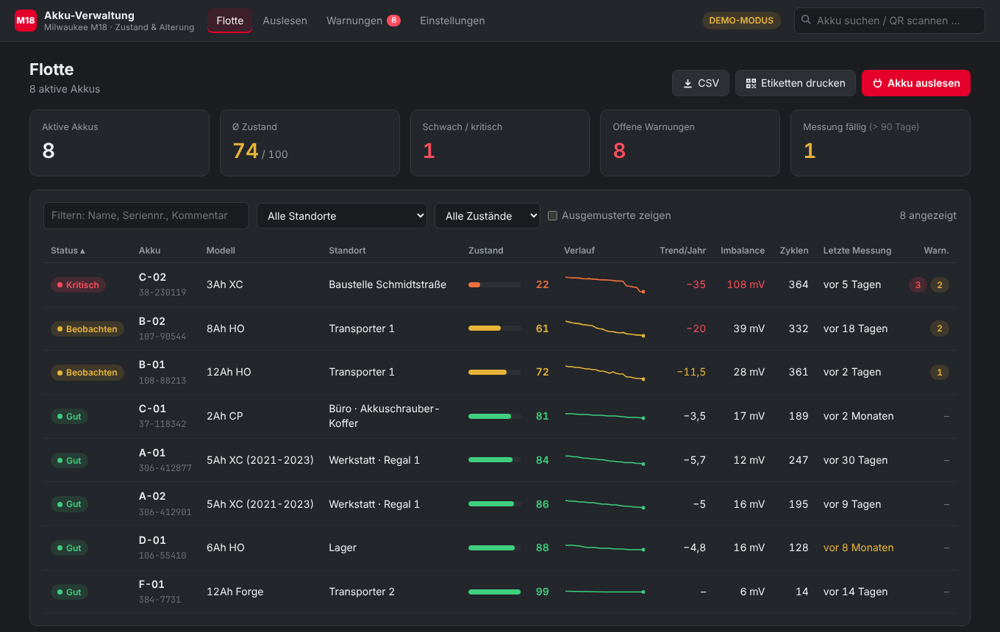
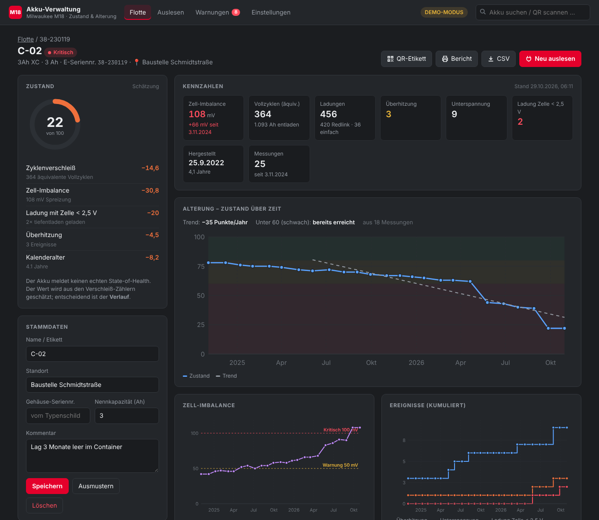
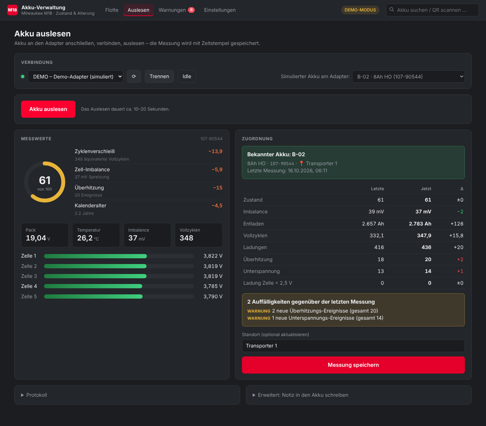

# M18 Akku-Verwaltung (Web-GUI)

Lokale Web-App zum Auslesen und Verwalten von Milwaukee-M18-Akkus auf Basis von `m18.py`.
Sie läuft als kleiner Webserver auf dem eigenen Rechner und braucht kein Framework und keine Installation:
außer `pyserial` für den Adapter genügt die Python-Standardbibliothek.

- **Auslesen**: Adapter verbinden, Akku auslesen. Bekannte Akkus werden über die
  E-Seriennummer automatisch erkannt, neue lassen sich direkt anlegen.
- **Datenbank** (SQLite): Jede Messung wird mit Zeitstempel gespeichert. Zellspannungen, alle Zähler
  und die rohen Registerwerte bleiben erhalten.
- **Flotte**: alle Akkus auf einen Blick mit Zustand, Verlauf, Trend, Imbalance, Zyklen,
  letzter Messung, Standort und Warnungen. Die Liste lässt sich filtern und sortieren.
- **Alterung**: Diagramme je Akku und Trend-Prognose („wann unter 60 %“).
  **Warnungen** gibt es, wenn sich ein Akku beim Auslesen deutlich verschlechtert.
- **Standort und Kommentar** sind je Akku editierbar, ebenso Name/Etikett,
  Gehäuse-Seriennummer und Nennkapazität. Akkus lassen sich ausmustern.
- **QR-Etiketten** für P-touch (12/18/24/36 mm) und Brother QL (62 mm), druckbar oder als PNG für
  den P-touch Editor. Die QR-Codes werden offline erzeugt (eigener Encoder in `qrgen.py`).
- **Berichte**: druckbare A4-Seite pro Akku (auch als PDF speicherbar) und CSV pro Akku bzw. für die
  ganze Flotte (Excel-DE oder international). Dazu gibt es ein Datenbank-Backup als Download.

## Start

```bash
pip install pyserial
python gui/m18_gui.py
```

Der Browser öffnet sich mit http://127.0.0.1:8018. Unter Windows startest du mit `py gui\m18_gui.py`.

| Option | Bedeutung |
|---|---|
| `--demo` | Simulierte Flotte (8 Akkus, ca. 2 Jahre Verlauf), keine Hardware nötig |
| `--port COM5` | Beim Start direkt mit diesem Port verbinden |
| `--db pfad.db` | Andere Datenbankdatei (Standard: `data/m18_fleet.db`) |
| `--host 0.0.0.0` | Im LAN erreichbar, z. B. damit ein Handy einen QR-Code öffnen kann |
| `--http-port 8018` | Port des Webservers |
| `--no-browser` | Browser nicht automatisch öffnen |

Der Demo-Modus nutzt eine temporäre Datenbank. Auf der Seite „Auslesen“ wählst du,
welcher simulierte Akku „am Adapter steckt“. Jede Demo-Messung simuliert 3–8 Wochen Nutzung;
der Akku **C-02** altert dabei sichtbar und löst Warnungen aus.

## Ablauf mit echter Hardware

1. Adapter anschließen und den Akku aufstecken. Möglich sind zwei Varianten:
   - 3,3-V-USB-Seriell-Adapter (Verdrahtung siehe Haupt-README)
   - [ESP32-Brücke](../esp32-bridge/README.md) über USB oder WLAN
2. **Auslesen** → Adapter und Port bzw. WLAN-Adresse wählen → **Verbinden** → **Akku auslesen** (dauert ca. 10–20 s).
3. Bei einem neuen Akku Name, Standort und Kommentar eintragen und **Akku anlegen & Messung speichern** klicken.
   Bei einem bekannten Akku zeigt die Seite den Vergleich zur letzten Messung und mögliche
   Warnungen; gespeichert wird mit **Messung speichern**.
4. **QR-Etikett drucken** und auf den Akku kleben. Danach findet ein Scan (Handy oder USB-Scanner)
   die Detailseite.

Tipp: Für vergleichbare Imbalance-Werte immer im gleichen Ladezustand messen, z. B. voll geladen.

## Messungen von der ESP32-Brücke übernehmen

Messungen, die direkt an der [ESP32-Brücke](../esp32-bridge/README.md) gemacht wurden (z. B. mit dem Handy beim Kunden),
liegen zunächst nur auf der Brücke. So kommen sie in die Datenbank:

- **Brücke erreichbar:** **Auslesen** → Brücke verbinden. Die Karte **„Auf der Brücke gespeichert“** erscheint;
  dort auswählen und auf **Übernehmen** klicken.
- **Brücke nicht erreichbar:** Auf der Brücke **Verlauf → „Alle als JSON exportieren“**, hier
  **Einstellungen → „Messungen der ESP32-Brücke importieren“**.

Was beim Übernehmen passiert:
- Neue Akkus werden angelegt.
- Standort und Kommentar aus der Messung werden übernommen.
- Doppelte Messungen werden übersprungen.
- Warnungen entstehen wie bei einer Messung am PC.
- In der Messliste steht als Quelle `esp`.

Ist die Brücke passwortgeschützt, fragt die GUI beim Verbinden danach und merkt es sich.

## Zustand und Warnungen

Der Akku meldet keinen echten State-of-Health. Der **Zustand (0–100)** ist eine Schätzung:
100 Punkte minus Abzüge für

- Zyklenverschleiß: Entladung (Ah) ÷ Nennkapazität = äquivalente Vollzyklen
- Zell-Imbalance
- Ladungen mit einer Zelle < 2,5 V
- Überhitzung
- Kalenderalter

Die App zeigt jeden Abzug einzeln an. Aussagekräftig ist vor allem der **Verlauf**.

Warnungen entstehen beim Speichern einer Messung im Vergleich zur vorigen Messung:

| Auslöser | Warnung | Kritisch |
|---|---|---|
| Zustand fällt | ≥ 5 Punkte | ≥ 10 Punkte |
| Zell-Imbalance erreicht | 50 mV | 100 mV |
| Imbalance steigt um | ≥ 25 mV | – |
| Neue Überhitzung / Unterspannung | ja | – |
| Neue Ladung mit Zelle < 2,5 V | – | ja |
| Zellspannung beim Auslesen | < 3,0 V | < 2,5 V |

Alle Schwellen stehen oben in `gui/fleet.py`.

## QR-Codes

Der QR-Code enthält `<Basis-URL>/b/<E-Seriennr.>`, z. B. `http://werkstatt-pc:8018/b/306-412877`.
Die Basis-URL stellst du in den **Einstellungen** ein. Damit ein Handy-Scan im WLAN funktioniert, trägst du
die LAN-Adresse des PCs ein und startest die App mit `--host 0.0.0.0`.

Achtung: Dann kann jeder im LAN die Daten sehen und ändern.

Ohne Netzwerk funktioniert es auch: Ein USB-Barcode-Scanner „tippt“ den Inhalt einfach in die App,
und das Suchfeld akzeptiert URL, E-Seriennummer, Name oder Gehäuse-Seriennummer.

Die E-Seriennummer stammt aus dem Akku (Register 0x0004) und ist **nicht** die Seriennummer auf dem Gehäuse.
Die Gehäuse-Seriennummer kannst du zusätzlich erfassen.

## Dateien

| Datei | Inhalt |
|---|---|
| `m18_gui.py` | Webserver, REST-API, Register-Dekodierung, Hardware-Zugriff über `m18.py`, CSV |
| `fleet.py` | SQLite-Schema und -Zugriff, Zustandsschätzung, Warnlogik, Trend |
| `qrgen.py` | QR-Code-Encoder (reines Python, SVG/PNG) |
| `demo.py` | Simulierte Flotte und simulierter Adapter |
| `static/` | Oberfläche (HTML/CSS/JS ohne Framework), Etiketten- und Berichtsseite |
| `tests/` | `python -m unittest discover -s gui/tests` |

Datenbank-Schema: `batteries` (Stammdaten), `readings` (eine Zeile pro Messung, inkl. `raw`-JSON aller
Register), `alerts` und `settings`. Die Versionierung läuft über `PRAGMA user_version`.

## Screenshots (Demo-Modus)




